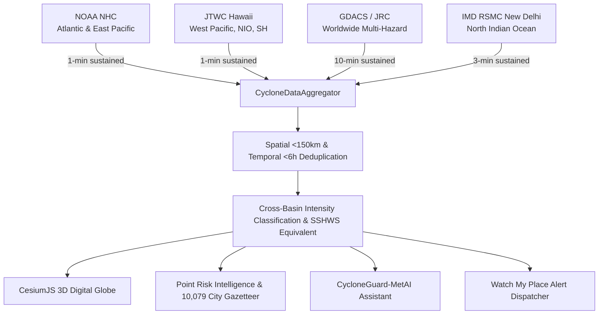

# CycloneGuard AI — Real-Time Global Cyclone Risk Intelligence

> **Predict · Assess · Explain · Prepare · Protect**  
> An enterprise-grade, full-stack geospatial intelligence and disaster early-warning platform. Built with **Flask**, **CesiumJS (3D Digital Earth)**, **Doppler Eyewall Radar Reflectivity**, **Physics-Informed ML Trajectory Forecasting**, **Global Multi-Agency Ingestion (NOAA NHC, JTWC, GDACS, IMD)**, **NASA GIBS Geostationary Clean Infrared Satellite Imagery**, and community alert dispatch via **Telegram Bot API**.


---

## 🌟 Architecture & Global Data Pipeline

CycloneGuard AI continuously aggregates, deduplicates, and standardizes tropical cyclone advisories across **all global ocean basins** in real time:



### 1. Data Sources Table

| Source / Agency | Basin Coverage | Update Frequency | Wind Averaging Period | Native Scale | Authentication |
| :--- | :--- | :--- | :--- | :--- | :--- |
| **NOAA NHC** | North Atlantic, Eastern North Pacific, Central Pacific | Every 3–6 hours | 1-minute sustained | Saffir-Simpson Hurricane Wind Scale (Cat 1–5) | Public Keyless |
| **Joint Typhoon Warning Center (JTWC)** | Western Pacific, North Indian Ocean, Southern Hemisphere | Every 6 hours | 1-minute sustained | JTWC Typhoon / Super Typhoon Scale | Public Keyless |
| **GDACS (JRC / WMO)** | Global (All Basins Worldwide) | Every 30–60 minutes | 10-minute sustained | GDACS Alert Level (Green / Orange / Red) | Public Keyless |
| **IMD RSMC New Delhi** | North Indian Ocean (Bay of Bengal & Arabian Sea) | Continuous 3-hourly | 3-minute sustained | IMD Cyclonic Scale (D, DD, CS, SCS, VSCS, ESCS, SuCS) | Public Keyless |
| **NASA GIBS** | Global Geostationary Satellite Imagery | Hourly Rapid Refresh | N/A (Infrared Brightness) | Clean IR (Himawari-9 AHI Band 13 / GOES-East ABI Band 13) | Keyless WMS |
| **Open-Meteo Weather** | Worldwide (Any Coordinate) | Real-Time | 10-meter surface wind | WMO Standard Atmospheric Units | Keyless REST |
| **World Cities Gazetteer** | Worldwide Coastal & Major Cities | Static Offline Tier | N/A | 10,079 Curated Populated Places | Local JSON |

---

## 🌊 Basin-Specific Intensity Scales

Tropical cyclone classification varies by regional meteorological authority. CycloneGuard AI preserves the native agency terminology while displaying a standardized **approximate equivalent Saffir-Simpson badge**:

| Ocean Basin | Monitoring Agency | Native Classification Scale | Wind Averaging Standard |
| :--- | :--- | :--- | :--- |
| **North Indian Ocean** | IMD RSMC New Delhi | Depression, Deep Depression, Cyclonic Storm, Severe Cyclonic Storm, Very Severe, Extremely Severe, Super Cyclonic Storm | 3-minute sustained |
| **Western North Pacific** | JMA / JTWC | Tropical Depression, Tropical Storm, Severe Tropical Storm, Typhoon, Super Typhoon | 1-minute (JTWC) / 10-minute (JMA) |
| **North Atlantic & East Pacific**| NOAA NHC | Tropical Depression, Tropical Storm, Category 1–5 Hurricane | 1-minute sustained |
| **Southern Hemisphere & Australia** | BoM / Météo-France | Tropical Low, Category 1–5 Tropical Cyclone | 10-minute sustained |

---

## 📊 Dynamically Computed Non-Hardcoded KPIs

Every metric displayed on the dashboard header and telemetry panels is computed from live ingested feeds:

1. **Active Cyclones**: Count of unique physical storm systems worldwide after spatial (< 150 km) and temporal (< 6 h) deduplication.
2. **Monitored Regions**: Number of populated cities/settlements from the 10,079 gazetteer located within active threat cones (< 350 km).
3. **People at Risk**: Sum of verified GDACS population exposure estimates across non-overlapping storm footprints.
4. **Critical Alerts**: Count of unique active storms meeting Category 3+ intensity or direct coastal landfall criteria.
5. **Data Sources Online**: Live health-check ratio (e.g. `8 / 8 Online`) measuring latency to each upstream adapter.

---

## 🌐 3D Digital Globe & Satellite Imagery

- **Track Visualization**:
  - **Solid Lines**: Observed historical storm tracks up to the current eye position.
  - **Dashed Lines**: Official agency forecast tracks projecting 24h to 72h future trajectory.
- **Marker Intensity Coloring**: Markers dynamically color-code according to sustained wind velocity (Red: Cat 3–5, Amber: Cat 2, Cyan: Cat 1 / TS, Emerald: Tropical Depression).
- **Real Satellite Infrared**: NASA GIBS geostationary clean infrared imagery from Himawari-9 (Asia-Pacific) and GOES-East (Americas). Basins without geostationary coverage gracefully display `"No imagery"`.

---

## 🔎 Universal Location Search & Point Intelligence

- **Universal Search**: Type any city, island, or town worldwide (e.g., *Tokyo*, *Miami*, *Mumbai*, *Puri*, *Manila*, *Taipei*) into the top search bar.
- **Point Intelligence Card**: Clicking anywhere on the globe or searching a place:
  - Identifies district/town name, state, and country (or ocean basin if in open waters).
  - Fetches real-time weather from Open-Meteo.
  - Evaluates proximity to all active storms:
    - If distance > 1500 km or all basins quiet: Displays `🛡️ NO ACTIVE CYCLONE THREATENING THIS AREA` with green `SAFE` badge.
    - If distance ≤ 1500 km: Computes threat tiers (`CRITICAL`, `HIGH`, `MODERATE`, `WATCH`) with projected peak winds, expected rainfall, coastal surge, and evacuation guidance.

---

## 🌊 Zero-Storm Calm State & Demo Mode

### 1. Ocean Calm State
When nature is quiet and zero tropical cyclones are active worldwide:
- The top header KPIs cleanly reflect `0 Active Cyclones`, `0 People at Risk`, `0 Critical Alerts`.
- The right panel displays the **WMO Upcoming Storm Names List** for the current season across RSMC New Delhi, JMA Tokyo, NOAA NHC, and BoM.
- Users can toggle the **Historical Storm Archive** to inspect benchmark historical cyclones (e.g., 1999 Odisha Super Cyclone, Cyclone Fani, Hurricane Katrina, Typhoon Haiyan).

### 2. Demo Mode (`DEMO_MODE=true`)
To evaluate UI components, training drills, or disaster simulations during calm weather:
- Set `DEMO_MODE=true` in your `.env` or append `?demo=true` to the URL:
  ```
  http://127.0.0.1:5000/?demo=true
  ```
- CycloneGuard AI injects a high-fidelity benchmark scenario (**Super Cyclonic Storm MAYA**) with complete multi-agency wind consensus, past and forecast tracks, and key coastal locations.
- A prominent amber badge (`⚠️ DEMO MODE: BENCHMARK SIMULATION`) is displayed in the header to ensure transparency.

---

## 📡 REST API Reference

| Endpoint | Method | Parameters | Description |
| :--- | :--- | :--- | :--- |
| `/api/storms/active` | `GET` | `refresh=true`, `demo=true` | Returns all active global storms, dynamic KPIs, and data provenance |
| `/api/health` | `GET` | None | Real-time health status, per-adapter ping latency, and online ratio |
| `/api/places/search` | `GET` | `q=<query>` | Universal search matching active storms, 10,079 gazetteer places, or geocoding |
| `/api/point/intelligence` | `GET/POST` | `lat=<float>`, `lon=<float>` | Real-time weather, reverse geocode, and cyclone proximity threat assessment |
| `/api/shelters` | `GET` | None | Emergency cyclone shelters with capacity, occupancy, and available space |
| `/api/simulation` | `POST` | `wind_delta_percent`, `tide_delta_m` | What-If storm surge and population inundation exposure simulation |
| `/api/ai/chat` | `POST` | `message=<string>` | Domain-restricted CycloneGuard-MetAI natural language assistant |

---

## 🧪 Automated Test Suite

Run the complete 21-test validation suite:
```bash
python -m unittest discover tests
```

Tests cover:
- Real-time adapter fetching (`NHCAdapter`, `JTWCAdapter`, `GDACSAdapter`, `IMDAdapter`).
- Spatial (< 150 km) and temporal (< 6 h) multi-agency deduplication.
- All basin-specific intensity scales (IMD, JMA, SSHWS, BoM).
- Ocean calm state and `DEMO_MODE` toggling.
- Point intelligence proximity math and universal gazetteer search.

---

## ⚠️ Official Meteorological Disclaimer

> **IMPORTANT NOTICE:** CycloneGuard AI is an automated geospatial intelligence and decision-support research platform. It is **not** an official national forecasting or civil protection agency. For official life-safety directives, evacuation mandates, and marine bulletins, always follow your respective national meteorological authority:
> - **India**: [India Meteorological Department (IMD)](https://mausam.imd.gov.in/)
> - **United States**: [NOAA National Hurricane Center (NHC)](https://www.nhc.noaa.gov/)
> - **US Military / Indo-Pacific**: [Joint Typhoon Warning Center (JTWC)](https://www.metoc.navy.mil/jtwc/jtwc.html)
> - **Japan / West Pacific**: [Japan Meteorological Agency (JMA)](https://www.jma.go.jp/)
> - **Australia**: [Bureau of Meteorology (BoM)](http://www.bom.gov.au/)
